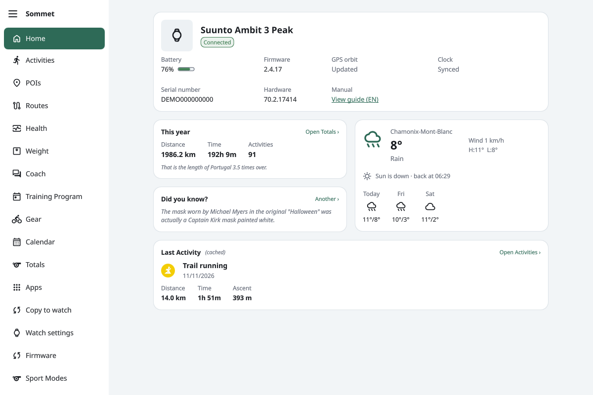
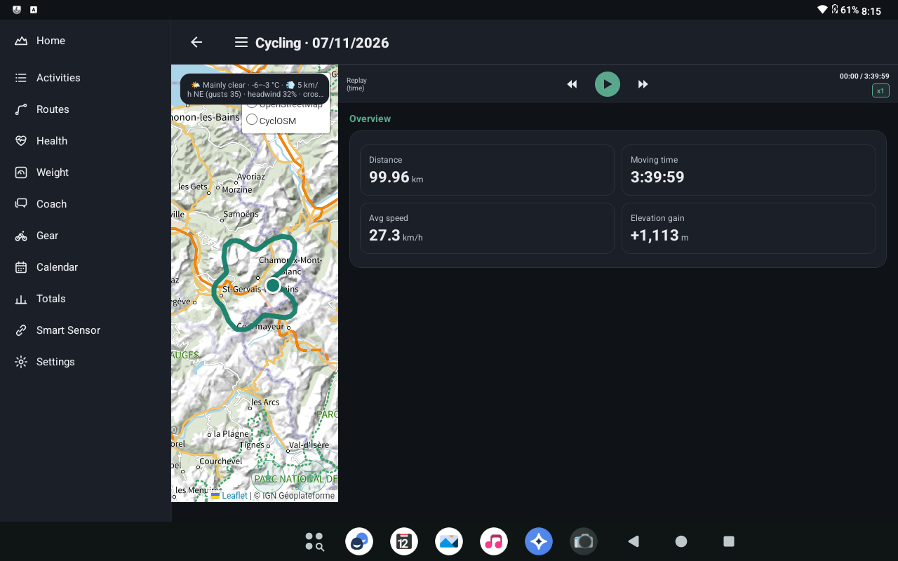

# Sommet

Sommet keeps Suunto's Ambit, Traverse and Kailash watches in use after Movescount. Send routes
and POIs, edit sport modes and settings, and download your activities on Linux, Windows, macOS,
or Android, over USB or Bluetooth. It's free, needs no account and works offline.

**[Download the latest release](https://github.com/skinnie/sommet/releases/latest)** · **[Website](https://skinnie.github.io/sommet/)** · [Supported watches](https://skinnie.github.io/sommet/watches/) · [FAQ](https://skinnie.github.io/sommet/faq/)

| Desktop | Android |
|:---:|:---:|
|  |  |

## Your Suunto

| Watch | Connects over |
|---|---|
| Ambit (the first one) | USB |
| Ambit2, Ambit2 S, Ambit2 R | USB |
| Ambit3 Peak, Sport, Run, Vertical | USB, Bluetooth |
| Traverse, Traverse Alpha | USB, Bluetooth |
| Kailash | USB, Bluetooth |

## What it does

- **Routes:** send a GPX route with its map and climb, remove routes, and export the ones on the
  watch.
- **POIs:** add them from a map search or coordinates, remove them, export them. A Traverse gets
  its own 48 POI types.
- **A library of your own:** Sommet keeps your routes and POIs in its own library, apart from
  what is on a watch. Keep everything there and send each watch only what it needs: a 200 km
  ride to one, a 5 km loop to another. Deleting in the library never touches a watch. See
  [The library and your watches](docs/how-to/routes-and-pois-library.md).
- **Sport modes and settings:** edit modes, data screens, apps, and the watch's settings, and
  copy them from one watch to another.
- **Activities:** download them and see the map, charts, and heart-rate zones. Export GPX or FIT,
  or send them to Strava, Runalyze, intervals.icu or Garmin Connect.
- **Workouts:** the Ambit3's own WORKOUT menu is back, fed by a Training Program from
  intervals.icu or made in the app. The Ambit 1 and 2 get App Zone apps.
- **Keeping it working:** GPS orbit data, the clock, backups and restore, and a firmware flasher
  for emergencies.
- **Kailash:** the travel log, with the countries and places you visited.

[All features](docs/reference/features.md) · [Screenshots](docs/screenshots.md)

## Also works with

- **Garmin eTrex** 10, 20, 20x, 30, 30x: activities, POIs and routes
- **Bike computers:** Bryton Aero 60, Magene C406 Pro, Wahoo ELEMNT and ELEMNT BOLT, Garmin
  Edge, Hammerhead Karoo 3
- **Sensors:** Suunto Smart Sensor, Etekcity FIT 8S scale, Polar Verity Sense (sleep,
  experimental)
- **Experimental, with no device to test:** Suunto T6, T6c, T6d, X6HR and the GPS Track Pod

## Get it

From the [Releases](https://github.com/skinnie/sommet/releases) page:

- **Linux:** one AppImage file. USB needs a udev rule, once.
- **Android:** the APK. Use a USB-OTG cable or Bluetooth.
- **Windows:** the `.zip`. **macOS:** the `.dmg`. Both tested with a watch over the cable.

Step by step, with the udev rule: [Install Sommet](docs/how-to/install.md). To build it
yourself: [BUILDING.md](BUILDING.md).

On the desktop, use the cable when you can. Bluetooth works on Linux and Windows, but how fast
and how steady it is depends a lot on the computer's Bluetooth chipset and its driver, so it
can differ from one computer or USB adapter to the next. It's also slow next to the cable: a
new move takes about a minute, a first full read several. On Android, Bluetooth works well.
macOS Bluetooth isn't tested.

On Linux, Bluetooth needs two system packages, `python3-dbus` and `python3-gi` (most desktop
installs have them). The first time you pair a watch, your system asks for your password once:
Sommet switches Bluetooth privacy on for that pairing, because without it the watch refuses the
computer after its first sleep and you would pair again every time. More in
[Bluetooth on Linux](docs/how-to/bluetooth-on-linux.md).

## More

[F.A.Q.](docs/faq.md) · [Bluetooth on Linux](docs/how-to/bluetooth-on-linux.md) ·
[Why Sommet](docs/explanation/why-sommet.md) · [Contributing](CONTRIBUTING.md) ·
[Changelog](docs/reference/v3-changelog.md) · [Documentation](docs/index.md)

## Credits

Built on the work of [openambit](https://github.com/openambitproject/openambit) (`libambit`, by
Emil Ljungdahl), opensportsync, marguslt, Pavel Samokha,
[openScale](https://github.com/oliexdev/openScale),
[etekcity_esf551_ble](https://github.com/ronnnnnnnnnnnnn/etekcity_esf551_ble), sebchastang,
[openmoves](https://github.com/bwaldvogel/openmoves),
[gps_track_pod](https://github.com/iwanders/gps_track_pod),
[suunto-t6-sync](https://github.com/evelbulgroz/suunto-t6-sync), the App Zone examples of
[claha](https://github.com/claha/suunto),
[follesoe](https://github.com/follesoe/suunto-ambit-intervals),
[hefler](https://github.com/hefler/SuuntoApps),
[AdamHodgson](https://github.com/AdamHodgson/Suunto-Interval-Training) and
[Httqm](https://github.com/Httqm/Suunto), [goambit](https://github.com/ruvido/goambit),
[ambit2gpx](https://github.com/AlexLBraits/ambit2gpx),
[x6hr-python](https://github.com/nabeka/x6hr-python),
[suunto_x6hr_erl](https://github.com/larshesel/suunto_x6hr_erl),
[OpenBikeCompanion](https://github.com/Taxom/OpenBikeCompanion),
[C406pro_Hack](https://github.com/WSTRN/C406pro_Hack),
[Activity-Profile-Editor](https://github.com/fullcarbonbike/Activity-Profile-Editor),
[suunto-mcp](https://github.com/googlarz/suunto-mcp),
[openathlete](https://github.com/openathleteorg/openathlete),
[train-libre](https://github.com/rfivesix/train-libre) and
[suunto-sml-model](https://github.com/mihaildemidoff/suunto-sml-model), with the Suunto forum
community and wanarun.net. At runtime it uses
[python-garminconnect](https://github.com/cyberjunky/python-garminconnect),
[intervals.icu](https://intervals.icu/),
[wahoo-systm-mcp](https://github.com/joaodrp/wahoo-systm-mcp), Open Food Facts, USDA FoodData
Central, [ZXing-C++](https://github.com/zxing-cpp/zxing-cpp),
[react-native-camera-kit](https://github.com/teslamotors/react-native-camera-kit), the
optional Anthropic Claude API, Qt, and React Native. Maps © OpenStreetMap contributors (CyclOSM),
weather by Open-Meteo, approximate position by BeaconDB (IP data by DB-IP), icons from Google Material Symbols, mobile maps with
Leaflet, route POIs from PitStopper. Who did what, and under which licence:
[CREDITS.md](CREDITS.md).

Licensed under the [GNU GPLv3](LICENSE). Provided as is, without warranty. Not affiliated with
or endorsed by Suunto, Garmin or the other makers named here; their names are trademarks of
their owners.
