# Screenshots

Shown with the app's built-in sample watch and made-up activities around Chamonix (no real
person's data).

**Desktop** (Linux; the same app runs on macOS and Windows):

| | | |
|:---:|:---:|:---:|
| 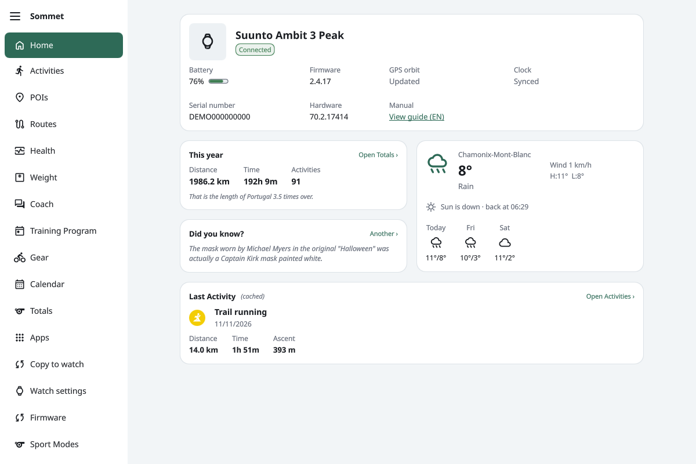 **Home** - the connected watch, this year, weather | 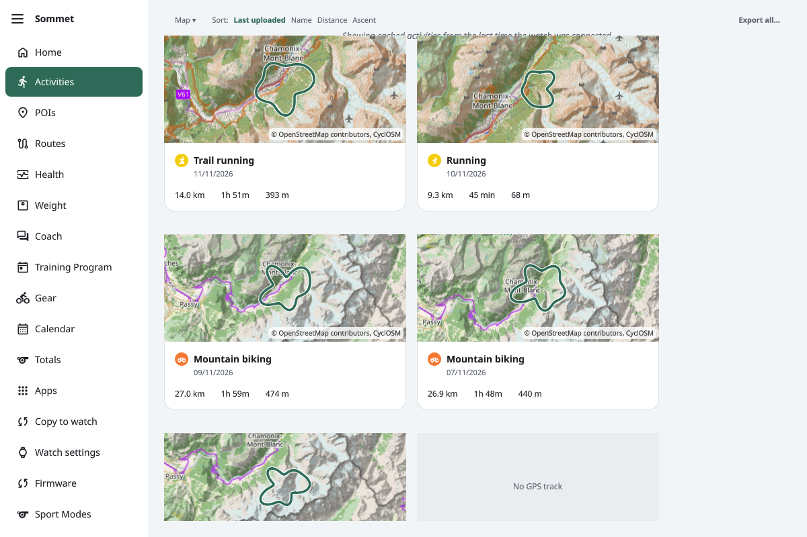 **Activities** - map cards | 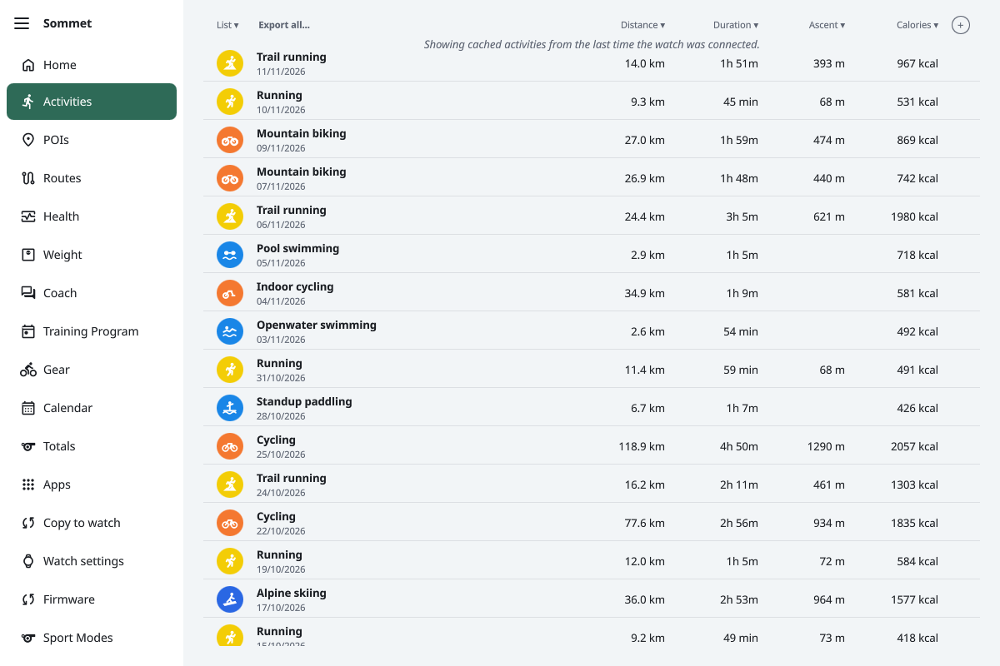 **Activities** - list, every sport |
| 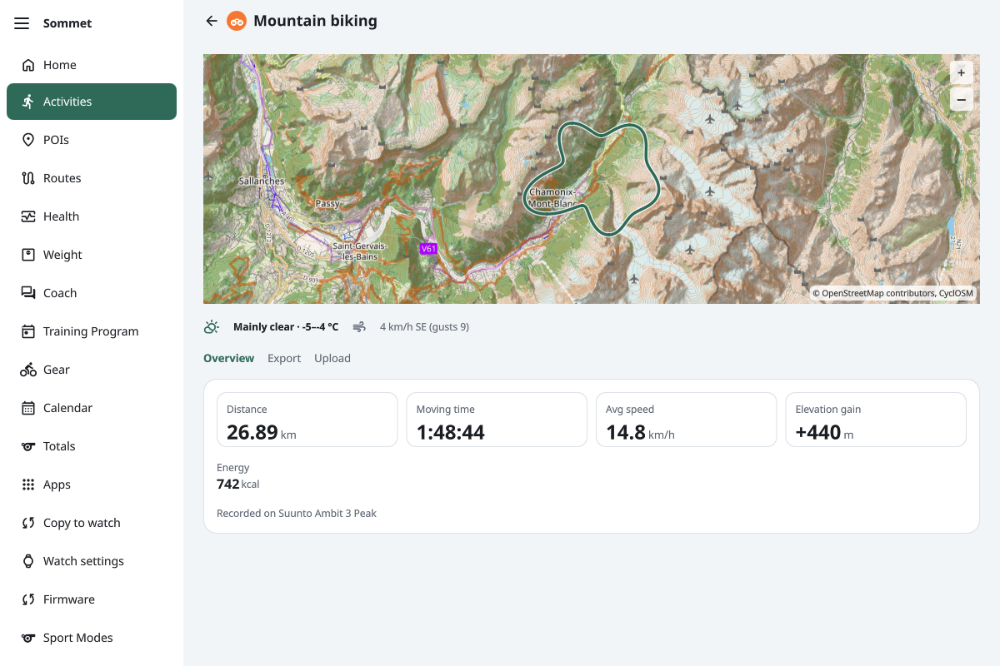 **An activity** - map, weather on the day, stats | 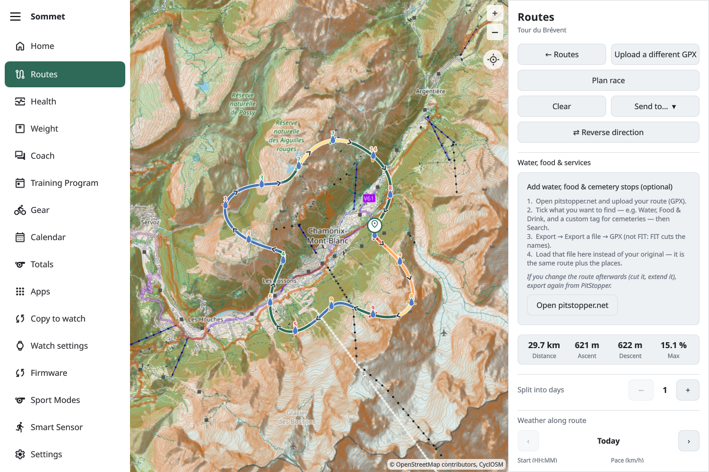 **Route planner** - climb colours, direction, weather | 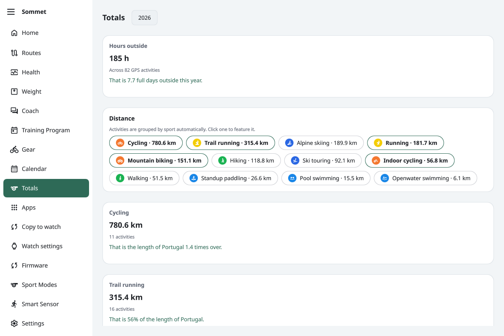 **Totals** by sport |
| 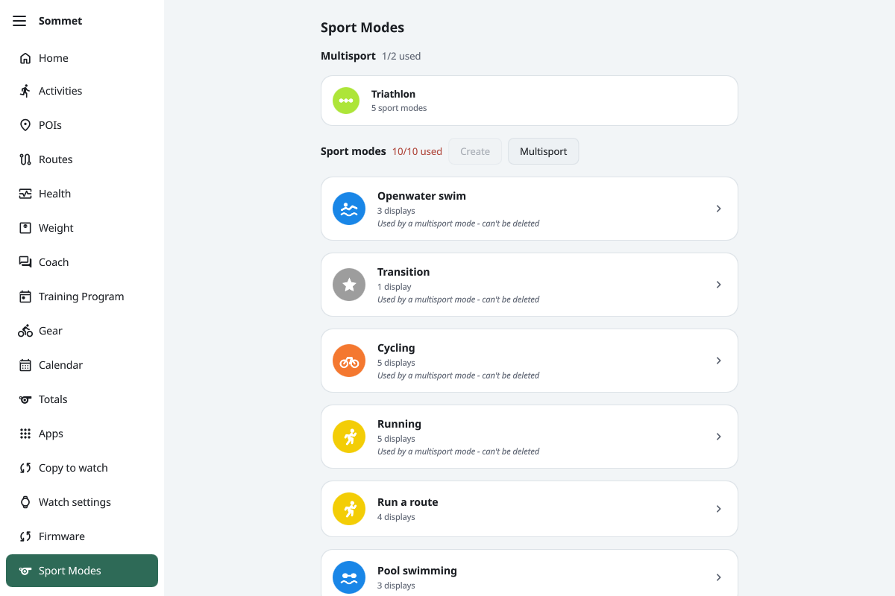 **Sport modes** on the watch | 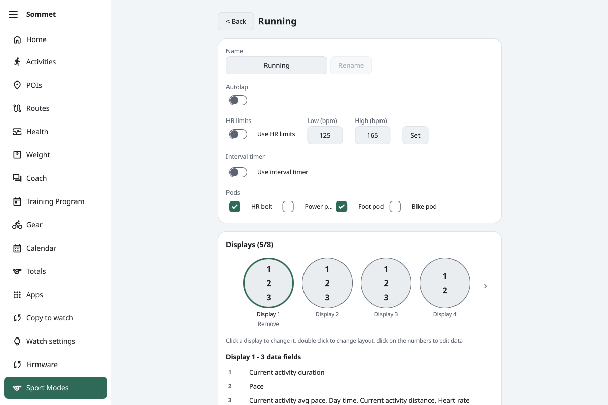 **A sport mode** - HR belt, foot pod, displays | 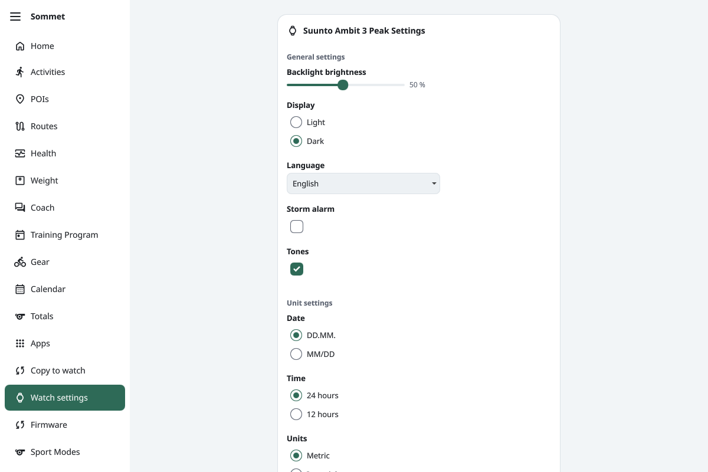 **Watch settings** |
| 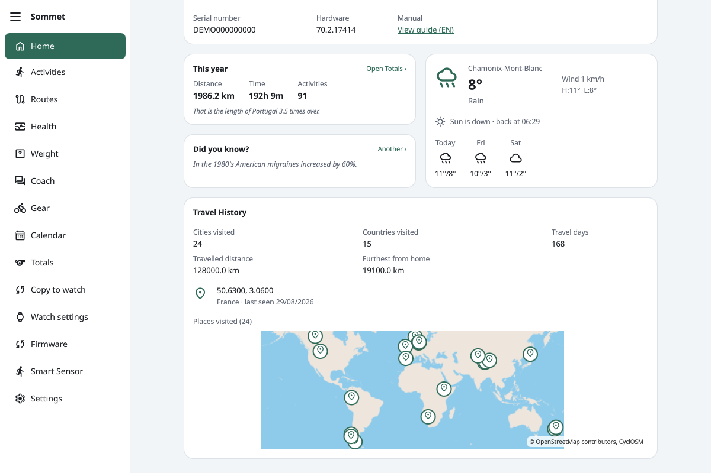 **Kailash** - travel history | 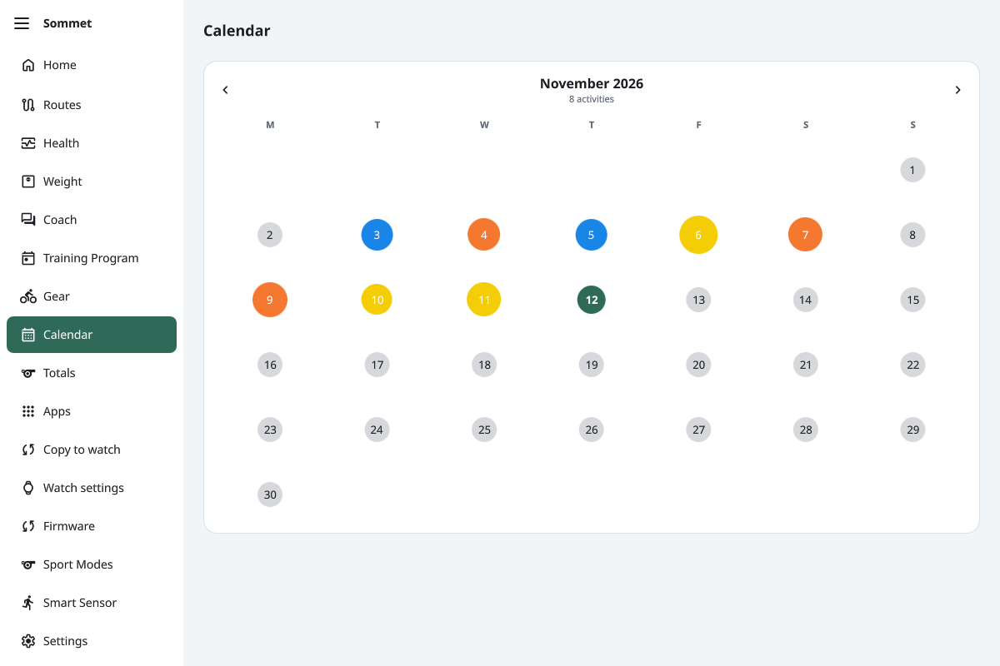 **Calendar** | 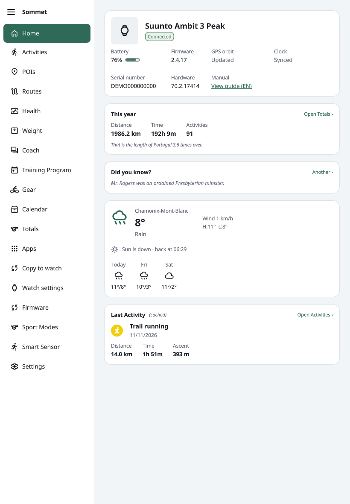 **Upright window** (portrait tablet) |

**Android** (tablet):

| | | |
|:---:|:---:|:---:|
| 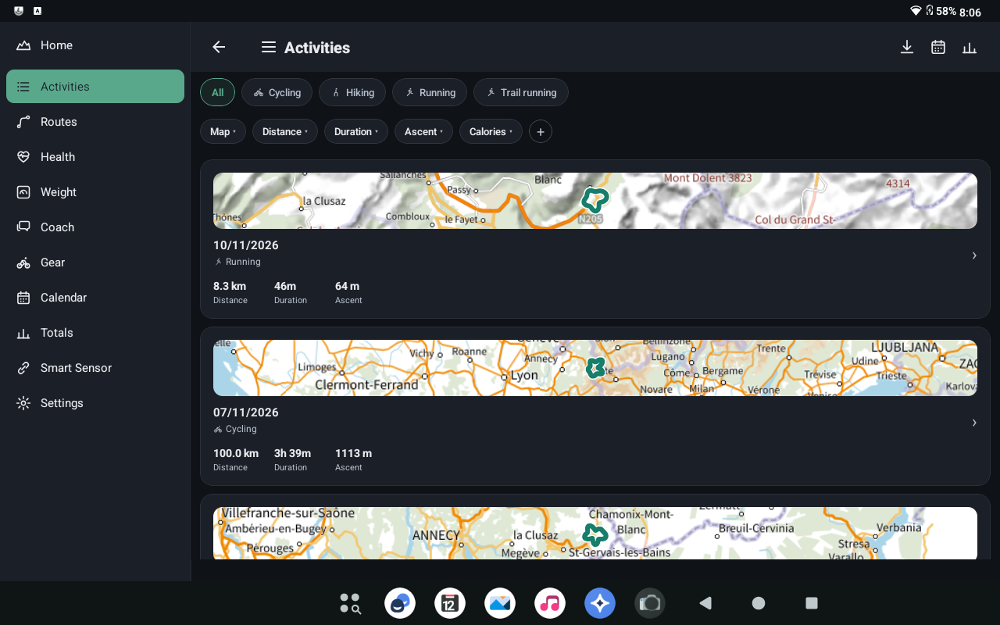 **Activities** | 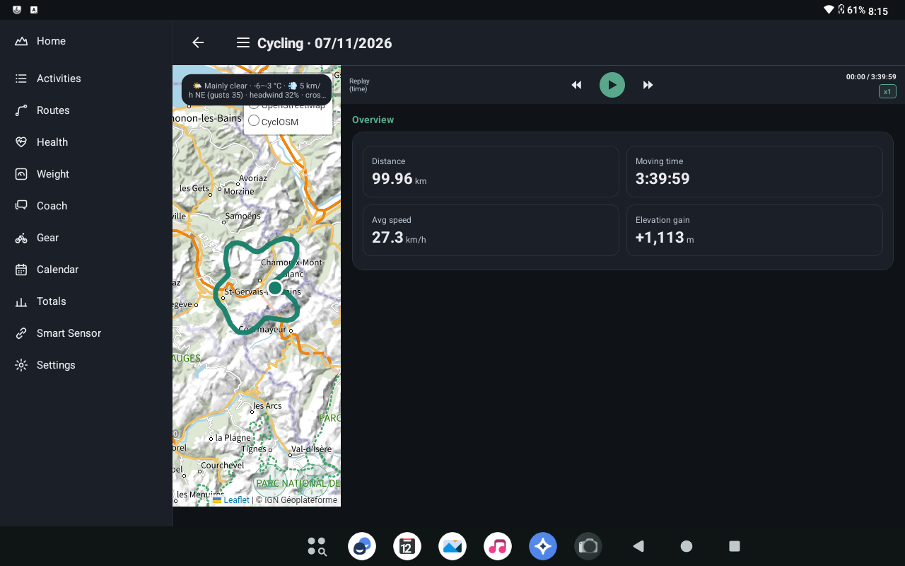 **An activity** | 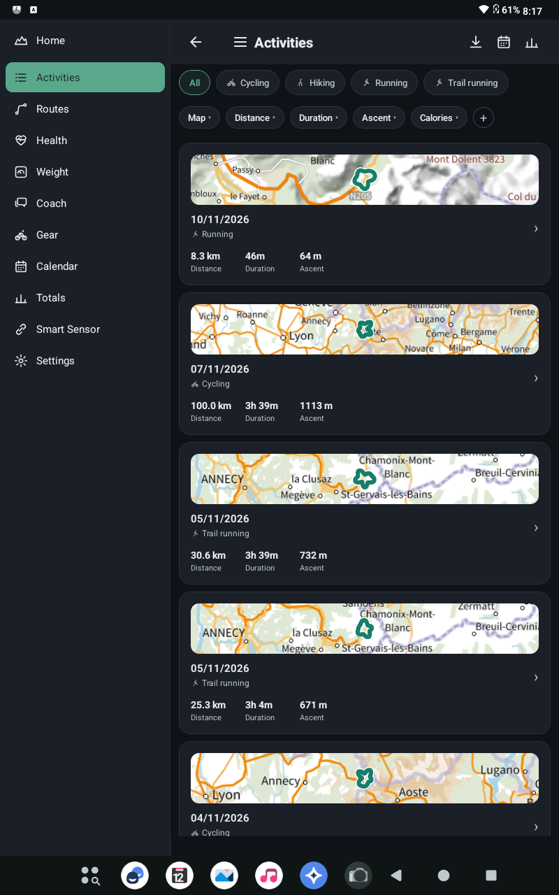 **Portrait** |
